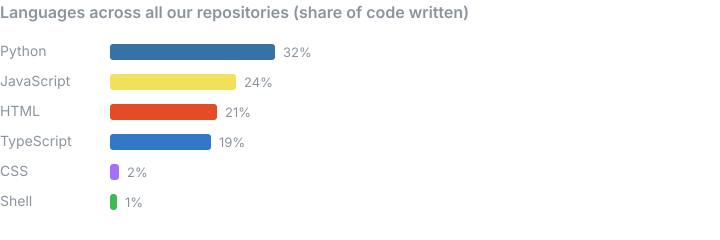
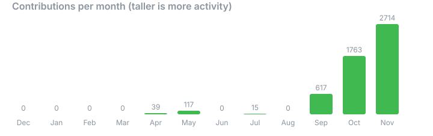

# Fezz-TVM-Labs

**Threat Vector Management.** Security strategy and threat research. We build tools with AI and share what's useful.

## How this work gets made
A person and AI coding assistants build everything here together. The person brings the ideas, the problems worth solving, the design decisions, the testing standards and the final review. The AI assistants write most of the code under that direction. We iterate fast, fail forward, and design products to self heal - down to the sbom components, rebuild, and regress to the latest working - in automated fashion. We find bugs and fixes and have begun to contribute those findings. 

## What we build
- **Gate and patch tooling** that tests code before it ships and keeps dependencies current.
- **Security tools** for exposure scanning, DNS protection and threat research.
- **Research and analysis apps** for real estate, investing and elections. To use, to share, but a lot for testing our security tools and developing against.

## How we work
- Small changes, each tested, published as soon as it passes.
- Every fix gets a test of the real output.
- Most of our repositories are private, so our activity graph shows their contributions as a count without names.

## What we've learned (our own mistakes, turned into rules)
- A figure that looks too big or too small is checked against a real source before anyone sees it.
- A "none found" result always says what was looked at.
- Every mistake gets a test that fails on the old behaviour, and we then check everything already built for the same mistake.
- A fix is not done until the live copy runs it.

## Contribute upstream
We offer fixes to open-source security projects. Each one is tested and disclosed as AI-assisted.

<!-- generated:start -->
## At a glance
| 5,265 | 5,257 | 44 |
|---|---|---|
| contributions in the last year | of them in private repositories | repositories we maintain |

## What we're good at
- **Self-healing software:** patching, testing and rolling back automatically.
- **Security tooling:** exposure scanning, DNS protection and threat research.
- **Data apps that check their own numbers:** real estate, investing and elections.
- **Testing:** every fix gets a test that fails on the old behaviour.

## What we write in

## How active we've been

<!-- generated:end -->

Site: https://threatvector.management · LinkedIn: https://www.linkedin.com/company/threat-vector-management/

